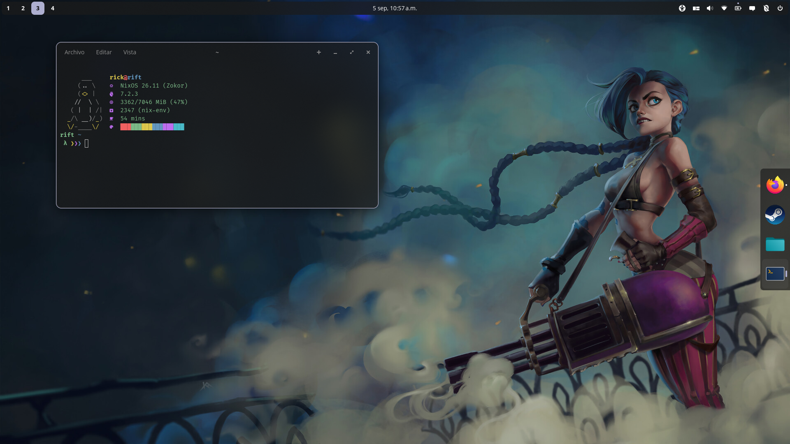
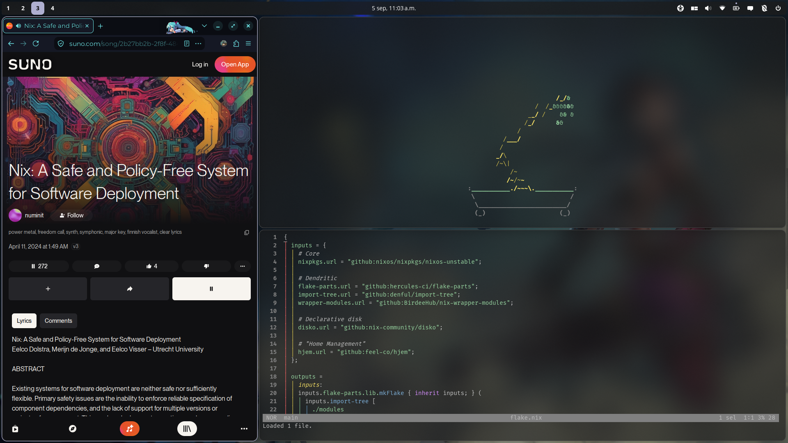

<h1 align="center">:snowflake: MarsOS :snowflake:</h1>
<p align="center">
   MarsOS is a simple way to replicate my setup on any NixOS system via a Flake.
</p>




## Design Philosophy

Inspired on [linuxmobile][linuxmobile]'s [Shin][Shin] and [olafkfreund][olafkfreund]'s [nixos-template][nixos-template] Configuration Structure, with a Full Dendritic Nix approach

<details>
<summary>Environment Software</summary>

|                         | Full Wayland Btw                    |
| ----------------------- | ----------------------------------- |
| **Desktop Environment** | [COSMIC][COSMIC]                    |
| **Shell**               | [Fish][Fish] + [Starship][Starship] |
| **Text Editor**         | [Helix][Helix]                      |
| **Fonts**               | [Nerd fonts][Nerd fonts]            |

</details>

<details>
<summary>Flake Directory Structure</summary>

```
MarsOS/
├── assets/
│   ├── wallpapers/
│   └── profile.png
├── hosts/{host}/
│         ├── default.nix
│         └── disko.nix
├── modules/
├── flake.nix
└── flake.lock
```

</details>

## Installation Guide

### Prerequisites

- A bootable NixOS ISO (Minimal installation recommended).
- **Internet connection with the network already configured.** The Minimal ISO
  boots without a configured connection; if you have no Ethernet, connect to
  Wi-Fi first:

  ```bash
  # Interactive Wi-Fi setup (iwd is the default on recent Minimal ISOs)
  iwctl --passphrase '<password>' station wlan0 connect <SSID>
  # Verify you are online before continuing
  ping -c1 cache.nixos.org
  ```

- The steps below install on **`/dev/nvme0n1`** with the BTRFS layout defined in
  each host's `hosts/<host>/disko.nix`:

  | Partition | Size | Filesystem |
  |---|---|---|
  | ESP (`/boot`) | 1 GB | vfat |
  | swap | 4 GB | swap (p2, no swapfile) |
  | root (`/`, `/home`, `/nix`, `/var/log`) | rest | BTRFS (subvolumes + zstd) |

  `/home`, `/nix` and `/var/log` are BTRFS **subvolumes**, so they get
  independent snapshots and share the free space with `/`. Change
  `device = "/dev/nvme0n1";` in `disko.nix` if your disk differs (check with
  `lsblk`).

  Swap is a **partition**, not a swapfile: a BTRFS swapfile is skipped by
  `scrub`/`balance` and prevents snapshotting its subvolume. It runs behind zram
  (priority 100) as a last resort.

### Steps

> **WARNING:** Disko formats the disk in `destroy` mode. **Everything on it is
> erased.** Back up your data first.

1. **Clone the repository (with its git history):**

```bash
   nix run nixpkgs#git -- clone https://github.com/RickMars-Tech/MarsOS.git
   cd MarsOS
```

> **Why git matters:** this flake uses `import-tree`, which **only imports
> files tracked by git**. If the repository is copied without its `.git`
> directory (e.g. a partial `cp`), the evaluation would silently skip your
> modules. Always install from a real `git clone`, or run `git add -A` inside
> the clone so every file is tracked.

2. **Apply the Disko layout (partitions + format + mount on `/mnt`):**

```bash
   sudo nix --experimental-features "nix-command flakes" \
     run github:nix-community/disko/latest -- \
     --mode destroy,format,mount --flake .#<host>
```

> **Note:** Replace `<host>` with your actual hostname (e.g., `rift`). Disko
> discovers the layout under `flake.diskoConfigurations.<host>`, so it always
> matches `hosts/<host>/disko.nix`.
>
> Disko mounts the freshly formatted root at `/mnt`. Verify with
> `findmnt /mnt` before continuing.

3. **Install the system from the flake:**

```bash
   sudo nixos-install --flake .#<host>
```

> **Note:** Replace `<host>` with your chosen hostname. `nixos-install` runs
> from the cloned repository and needs **network access** to fetch the flake's
> `github:` inputs (`nixpkgs`, `flake-parts`, `disko`, `hjem`, ...). If the
> install fails fetching inputs, re-check your connection with
> `ping -c1 cache.nixos.org`.
>
> You do **not** need to copy the flake to `/mnt/etc/nixos/` or run
> `nixos-generate-config`: `disko` already wrote the partition layout and the
> flake provides the filesystems.

4. **Set a root/user password (if prompted) and reboot:**

```bash
   sudo reboot
```

> Remove the USB drive when the machine restarts.

<!-- ## Documentation -->

<!-- - **[Creating Custom Hosts](./hosts/host.md)** - Learn how to create your own host configurations -->
<!-- - **[Configuration Options](./hosts/config.md)** - Complete reference of all Mars modules and options -->

## Important Notes

1. **Personal Configuration:** This Flake is specifically tailored for my systems (boltz, rift, and crest). You're welcome to use it as a base, modify the configuration files, or copy individual components that suit your needs.

2. **Boot Loader:** This configuration uses **systemd-boot**. GRUB support is
   not included, so you'll need to configure it manually if you prefer GRUB.

3. **Installation Environment:** For best results, install from a minimal NixOS environment without a pre-installed desktop environment.

## Credits & References

Special thanks to these excellent configurations that inspired and taught me so much:

- **[Gvolpe]** - Zaphkiel configuration.
- **[Tyler Kelley]** - ZaneyOS.
- **[Liassica]** - NixOS config.
- **[Ryan Yin]** - NixOS and Flakes book.
- **[shin]** - An elegant NixOS environment designed.
- **[nixos-template]** - A template to start you nixos journey.

<!----------------------------------{ Thanks }--------------------------------->

[Gvolpe]: https://github.com/Rexcrazy804/Zaphkiel
[Tyler Kelley]: https://gitlab.com/Zaney/zaneyos
[Liassica]: https://codeberg.org/Liassica/nixos-config
[Ryan Yin]: https://github.com/ryan4yin/nixos-and-flakes-book
[linuxmobile]: https://github.com/linuxmobile
[shin]: https://github.com/linuxmobile/shin
[olafkfreund]: https://github.com/olafkfreund
[nixos-template]: https://github.com/olafkfreund/nixos-template

<!--------------------------------{ Components }------------------------------->

[COSMIC]: https://github.com/pop-os/cosmic-epoch
[IWD]: https://git.kernel.org/pub/scm/network/wireless/iwd.git
[NetworkManager]: https://gitlab.freedesktop.org/NetworkManager/NetworkManager
[Yazi]: https://github.com/sxyazi/yazi
[Fish]: https://fishshell.com/
[Starship]: https://starship.rs/
[Helix]: https://helix-editor.com/
[Nerd fonts]: https://www.nerdfonts.com/
